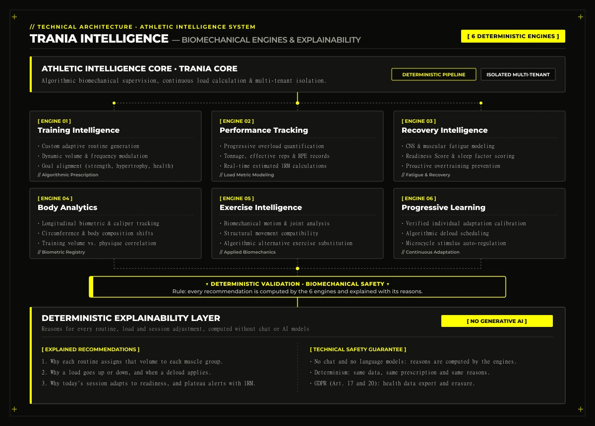

## 1. What is TranIA? Platform Overview

**TranIA** is a sports management platform built for gyms, fitness centres, boutique studios and personal trainers.

Its goal is to eliminate operational fragmentation by unifying business operations, member records, facility management, training plans and athletic performance tracking into a **single technology ecosystem**.

The platform has two complementary parts:

- **TranIA Manager:** Facility administration, operations, billing and club governance.
- **TranIA Intelligence:** Athletic intelligence: training planning, load progression and performance analytics.

TranIA is a **multi-gym (multi-tenant) SaaS**, usable from the browser and from a mobile app for members.

---

## 2. TranIA Manager — Sports Facility & Business Operations

The administrative module gives owners, managers and coordinators full control over the centre's operational areas:

<figure class="my-8">
  
  <figcaption class="mt-2 text-center text-xs font-mono text-[#a3a39b]">// Real TranIA Manager interface: command dashboard, active members, and facility operations</figcaption>
</figure>

### Members & Clients
- **Registration & lifecycle:** Individual profiles with activity history, contracts and administrative status.
- **Access control:** Entrance validation by scanning a **dynamic QR code** on the member's phone, with on-demand code rotation.
- **Memberships & renewals:** Management of dues, expiry dates and trainer assignment.
- **Attendance tracking:** Check-in logging and visit frequency.

### Memberships, Invoicing & Payments
- **Flexible pricing:** Recurring dues, day passes, session packages and promotions.
- **Invoicing:** Numbered invoices and printable PDF receipts compliant with Spanish RD 1619/2012.
- **Online payments:** Charges through Stripe Checkout, with a payment simulator for testing and subscriptions per category.
- **Financial traceability:** Financial history for each member.

### Staff, Trainers & Shifts
- **Staff management:** Professional profiles with granular roles and permissions per gym.
- **Assignment:** Linking members to trainers.
- **Schedules & tasks:** Staff working hours and task tracking.

### Classes & Group Activities
- **Calendar:** Group class planning with weekly recurrence.
- **Booking with capacity control:** Seat reservations and capacity limits per session.
- **Waitlists:** Automatic allocation of free seats after cancellations.

### Facilities, Equipment & Maintenance
- **Equipment inventory:** Catalogue of machines and facilities by zone.
- **Faults:** Technical incident reports and status tracking.
- **Maintenance:** Maintenance history and scheduled inspections.

<figure class="my-8">
  
  <figcaption class="mt-2 text-center text-xs font-mono text-[#a3a39b]">// Biomechanical exercise directory with movement pattern classifications</figcaption>
</figure>

### Reporting & Analytics
- **Metrics panel:** Active members, joins/leaves over the last 30 days, monthly revenue, pending payments and memberships expiring soon.
- **Occupancy:** Live facility occupancy.
- **Weekly volume:** Effective volume per muscle group for members and trainers, with a heat map.

---

## 3. TranIA Intelligence — Six Sports Engines & Explainability

Unlike generic fitness apps with fixed routines, TranIA bases its decisions on **six deterministic mathematical and biomechanical engines**:

1. **Training Intelligence:** Algorithmic routine generation by level, goal (strength, hypertrophy, endurance, health), available frequency and limitations.
2. **Performance Tracking:** Progressive overload tracking: tonnage, reps, estimated 1RM (Epley), RPE and performance curves.
3. **Recovery Intelligence:** Adaptation status and daily readiness to modulate session volume and prevent overtraining.
4. **Body Analytics:** Tracking of measurements, body composition and member progress.
5. **Exercise Intelligence:** Exercise library with substitutions based on available equipment (Smart Swap) and limitation compatibility.
6. **Progressive Learning:** Load progression and mesocycle periodisation with deload weeks based on each member's real training record.

### Deterministic Explainability
Every recommendation comes with its reasons, computed by the engines, with no chat and no language models:
- Why a routine assigns that volume to each muscle group.
- Why a load goes up or down, and when a deload is applied.
- Why today's session is adapted according to readiness.
- Plateau alerts with the exercise history and estimated 1RM.
- Reasons for each exercise substitution based on available equipment (Smart Swap).

---

## 4. Member Experience & White Label Architecture

### Member App (Web & Mobile)
Each member can:
- View the day's workout and swap exercises for others using available equipment (Smart Swap).
- Log sets, weights and reps, with autocomplete, a rest timer with notification and a live workout mode.
- Create free-form workouts and add or remove exercises on the fly.
- Calculate the plates needed for each barbell load.
- Track progress with charts for strength, measurements and weekly volume.
- Import and export their history from Hevy or Strong, and export their data under GDPR (Art. 20).
- Share a workout summary branded with their gym's identity.
- Book group classes.
- Access a digital membership card with a **QR code** for turnstile entry.
- Train without a gym: a personal account with a private space and no membership.

### White Label Customization per Gym
Each centre applies its own brand identity without custom development:
- Logo, business name and colour palette applied across the interface.
- Members see their gym's identity when they sign in.
- Shared infrastructure with data isolated per gym.

---

## 5. Roadmap & Future Capabilities

Planned development lines, not yet available:

- **A. Interactive gym floor plan:** Zone-based facility map with equipment rearrangement and per-station status.
- **B. Advanced financial control:** Profitability dashboard with outstanding invoices, fixed and variable costs and cash-flow projection.
- **C. Intelligent maintenance management:** Lifecycle tracking for each machine (warranty, usage hours, accumulated cost) to decide between repair and replacement.
- **D. Real-time occupancy:** Room occupancy measurement through QR turnstiles and IoT sensors.
- **E. Purchasing & inventory:** Stock of consumables and retail products, with replenishment orders.
- **F. Document vault:** Encrypted storage for contracts, mandatory inspections and insurance.
- **G. TranIA Business Intelligence:** Predictive models for churn risk and profitability by membership type.
- **H. Retention automations:** Messages to inactive members, dues reminders and equipment service alerts.

---

## 6. Commercial Model & Deployment Options

<figure class="my-8">
  
  <figcaption class="mt-2 text-center text-xs font-mono text-[#a3a39b]">// Multi-tenant gym network and franchise administrative panel in TranIA</figcaption>
</figure>

- **TranIA Standard:** Uses TranIA's visual identity.
- **TranIA Custom (White Label):** Gym's own identity across web and mobile.
- **Plans:**
  - **Free:** up to 50 members and 2 trainers, essential management.
  - **Pro:** up to 250 members and 10 trainers, sports intelligence, tracking and wellness.
  - **Elite:** unlimited members and trainers, advanced analytics.
- **Plan limits:** when the member or trainer quota of the plan is reached, the system blocks new registrations until the plan is upgraded.
- **Isolated VPS deployment:** Dedicated installations for franchises with database isolation requirements.

---

## 7. Engineering Philosophy & Architecture

- **Single codebase:** One codebase for web, backend and engines, with no diverging branches.
- **Modular architecture:** Clear separation between business management (TranIA Manager) and calculation engines (TranIA Intelligence), which are pure Python with no database or UI dependencies.
- **Strict data isolation:** Multi-tenant model with logical partitioning per gym.
- **Sports determinism:** Every training decision is computed with verifiable algorithms and explained to the member. No generative AI and no external AI APIs are used.
- **Privacy & GDPR:** Data export (Art. 20) and erasure (Art. 17) for members' health data.
- **Technological sobriety:** Few dependencies, native performance and contained server costs: PostgreSQL and Uvicorn tuned to run on 4 GB of RAM.

---

## 8. Final Vision

TranIA was built to close the gap between club administration software and training apps. It is one ecosystem where efficient business management translates directly into each member's physical progress.

**TranIA: intelligent gym management and intelligent athletic progression.**
