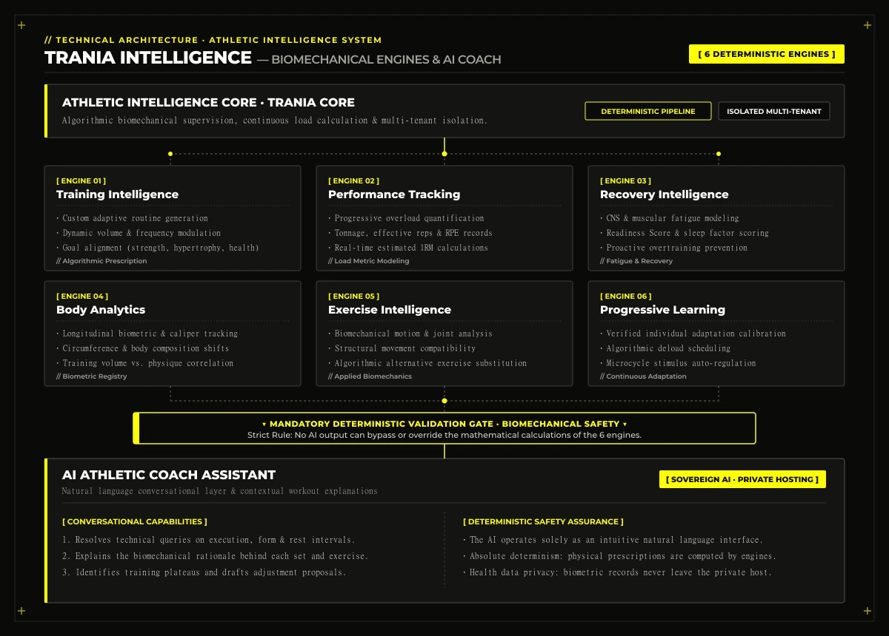

## 1. What is TranIA? Platform Overview

**TranIA** is a next-generation sports management and athletic performance platform engineered specifically for gyms, fitness centres, boutique studios, and personal trainers.

Its core objective is to eliminate traditional operational fragmentation by unifying club operations, member records, facility maintenance, adaptive workout planning, and continuous athletic performance tracking into a **single, cohesive technological ecosystem**.

The platform is organized around two complementary pillars:

- **TranIA Manager:** The central hub for facility administration, business operations, automated billing, and club governance.
- **TranIA Intelligence:** The athletic intelligence engine providing biomechanical planning, load progression, and physiological performance analytics.

TranIA is built as a **customizable, multi-gym (multi-tenant) SaaS** designed to deliver a seamless, high-performance experience across desktop browsers, mobile devices, and Progressive Web Apps (PWAs).

---

## 2. TranIA Manager — Sports Facility & Business Operations

The administrative module equips gym owners, club managers, and coordinators with complete operational control:

<figure class="my-8">
  
  <figcaption class="mt-2 text-center text-xs font-mono text-[#a3a39b]">// Real TranIA Manager interface: command dashboard, active members, and facility operations</figcaption>
</figure>

### Members & Clients
- **Registration & lifecycle tracking:** Complete individual profiles with consolidated activity records, contracts, and administrative statuses.
- **Frictionless access control:** Rapid entrance validation via **dynamic QR code** scanning on members' smartphones.
- **Memberships & renewals:** Lifecycle management for recurrent subscriptions, expiration dates, and personal trainer assignments.
- **Attendance tracking:** Real-time logging of facility check-ins and member visit frequencies.

### Memberships, Invoicing & Payments
- **Flexible pricing tiers:** Automated recurring dues, day passes, session packages, and targeted promotions.
- **Automated billing & payment runs:** Official invoice and receipt generation with integrated payment gateways and bank reconciliation.
- **Delinquency prevention:** Proactive detection of pending balances, expired cards, and automated renewal notices.
- **Financial auditability:** Comprehensive financial history tracked per member.

### Staff, Personal Trainers & Shift Rosters
- **Staff management:** Professional profile administration backed by granular, role-based access control (RBAC).
- **Client roster allocation:** Dynamic assignment of members to trainers based on goals, specialization, and availability.
- **Roster & task tracking:** Shift scheduling, operational check-ins, and daily staff task tracking.

### Classes & Group Activities
- **Timetable scheduling:** Weekly and monthly calendar planning for group sessions (spinning, pilates, HIIT, cross-training).
- **Real-time slot booking:** Automated room capacity management to eliminate overcrowding.
- **Dynamic waitlists:** Instant automatic seat reallocation upon cancellations with verified physical attendance tracking.

### Facilities, Equipment & Asset Management
- **Digital machine inventory:** Comprehensive asset registry with equipment identification codes and designated workout zones.
- **Operational status & incident reporting:** Immediate reporting and tagging of malfunctioning gym equipment.
- **Preventative maintenance:** Complete repair logs, scheduled inspections, and vendor/contractor records.

<figure class="my-8">
  
  <figcaption class="mt-2 text-center text-xs font-mono text-[#a3a39b]">// Biomechanical exercise directory with movement pattern classifications</figcaption>
</figure>

### Business Intelligence & Reporting
- **Single-pane executive metrics:** Real-time active members count, monthly churn rates, membership net growth, and recurring revenue (MRR).
- **Capacity & demand analytics:** Peak-hour attendance distribution and high-demand class tracking.

---

## 3. TranIA Intelligence — Six Specialized Sports Engines & Coach AI

Unlike generic fitness apps that rely on hardcoded static workout lists, TranIA powers workout science using **six specialized mathematical and biomechanical calculation engines**:

1. **Training Intelligence:** Algorithmic generation and progressive planning of custom training routines based on individual fitness level, primary goals (strength, hypertrophy, endurance, health), training frequency, and biomechanical constraints.
2. **Performance Tracking:** Continuous progressive overload tracking: total tonnage, effective reps, real-time estimated 1RM calculations, Rate of Perceived Exertion (RPE), and longitudinal progression curves.
3. **Recovery Intelligence:** Central nervous system and muscular fatigue modeling, sleep/rest factor evaluation, and physical readiness scoring to dynamically modulate upcoming training volume and prevent overtraining syndrome.
4. **Body Analytics:** Longitudinal biometric monitoring: body composition, anthropometric circumference metrics, body fat percentage, and visual physique tracking.
5. **Exercise Intelligence:** Biomechanical database cataloging joint compatibility, movement patterns, and algorithmic exercise substitution for athletes with injuries or structural limitations.
6. **Progressive Learning:** Adaptive stimulus adjustments based on verified individual response rates, refining deload frequencies and volume step increments over time.

### Proprietary AI Coach Assistant
TranIA features a conversational athletic assistant powered by **self-hosted, specialized AI models**:
- Resolves technical queries concerning exercise form, rest periods, and foundational recovery principles.
- Explains the biomechanical rationale behind each workout block directly to the member.
- Identifies training plateaus and provides evidence-backed adjustment recommendations.
- **Deterministic safety guarantee:** All training modifications are calculated and strictly validated by TranIA's deterministic sports engines. The AI acts as an intuitive, conversational advisory layer and **cannot arbitrary modify data or bypass biomechanical safety bounds**.

---

## 4. Member Experience & Multi-Tenant White Label Architecture

### Member App (Web & Mobile PWA)
Every gym member accesses a fast, installable interface offering:
- Daily workout views complete with technical cues, tempo, and guided rest timers.
- Set-by-set logging for weights lifted, reps completed, and perceived difficulty.
- Interactive progress charts mapping strength benchmarks and biometric changes.
- 1-tap group class booking with instant capacity confirmation.
- Digital membership pass featuring a **dynamic QR code** for turnstile entry.
- Subscription status, invoice history, and direct club notifications.
- On-demand interaction with the AI Coach assistant during workout sessions.

### White Label Club Customization
Each fitness facility showcases its unique brand identity without custom app development overhead:
- Custom logos, icons, and commercial branding.
- Full corporate color palettes applied across the interface.
- Custom onboarding screens, background imagery, and promotional banners.
- Members automatically see their gym's distinct branding upon sign-in, maintaining brand loyalty while running on a proven, reliable core infrastructure.

---

## 5. Future Roadmap & Platform Evolution

The following strategic capabilities define TranIA's roadmap for upcoming product milestones:

- **A. Interactive 2D/3D Gym Floorplan:** A visual, interactive facility mapping tool allowing drag-and-drop layout planning for strength, cardio, and functional areas. Enables space optimization, safety clearance checks, and live status monitoring of equipment directly on the map.
- **B. Advanced Financial & P&L Command Center:** Real-time business financial dashboard with issued and outstanding invoice tracking, fixed cost breakdown (utilities, staff salaries, software), variable maintenance outlays, cash-flow forecasts, and net profit margins.
- **C. Intelligent Equipment Asset Management:** Complete equipment lifecycle tracking (purchase dates, warranty windows, operating hours, spare parts costs, and labour expenses) with algorithmic repair-vs-replace decision analysis.
- **D. Real-Time Occupancy & Density Control:** Continuous club attendance monitoring powered by turnstile QR integration and IoT sensor compatibility, surfacing peak-hour heatmaps and automated capacity redistribution suggestions.
- **E. Inventory & Supply Chain Automation:** Automated stock tracking for consumables, auxiliary gym gear, and front-desk retail products (drinks, supplements), featuring automated vendor purchase orders and low-stock alerts.
- **F. Secure Digital Document Vault:** Encrypted, permission-controlled storage for member contracts, staff agreements, facility safety compliance certificates, and liability insurance documentation.
- **G. TranIA Business Intelligence:** Predictive machine learning models supporting strategic management: early member churn risk prediction, profitability analysis by membership tier, and optimal class scheduling.
- **H. Intelligent Workflow Automations:** Automated engagement funnels to re-engage inactive members, proactive membership renewal reminders, milestone celebrations, and scheduled machinery servicing alerts.

---

## 6. Commercial Model & Deployment Options

<figure class="my-8">
  
  <figcaption class="mt-2 text-center text-xs font-mono text-[#a3a39b]">// Multi-tenant gym network and franchise administrative panel in TranIA</figcaption>
</figure>

TranIA is designed to serve athletic organizations across all scales:

- **TranIA Standard:** Fast onboarding using TranIA's modern visual branding, ideal for personal training studios and boutique fitness spaces.
- **TranIA Custom (White Label):** Complete visual re-skinning with the gym's proprietary corporate identity across web and mobile experiences.
- **Tiered Subscription Plans:**
  - **Free:** Core essentials for solo trainers and micro-studios.
  - **Pro:** Complete facility administration, automated recurring payments, and core sports intelligence engines.
  - **Elite:** Advanced Business Intelligence, full White Label capabilities, automated workflows, and priority technical support.
- **Isolated VPS Deployment:** Option to deploy isolated dedicated VPS instances for large fitness chains and franchises with strict enterprise data segregation requirements.

---

## 7. Engineering Philosophy & Architectural Principles

TranIA is built upon robust software engineering principles aimed at long-term resilience:

- **Single Codebase Architecture:** Simplified maintenance and continuous deployment without diverging code branches.
- **Modular, Decoupled Design:** Strict architectural boundary separating operational business management (TranIA Manager) from mathematical computation engines (TranIA Intelligence).
- **Rigorous Multi-Tenant Data Isolation:** Secure logical tenancy boundaries safeguarding member health and financial data between competing facilities.
- **Sovereign, Self-Controlled AI:** Machine learning models hosted in private infrastructure to protect sensitive physical health and biometric records.
- **Deterministic Athletic Foundations:** While the AI assists and communicates, exercise science and biomechanical metrics are governed by deterministic algorithms.
- **Technological Sobriety:** Zero redundant external dependencies; prioritized native runtime performance, instant response times, and predictable infrastructure costs.

---

## 8. Final Vision

TranIA is built to bridge the gap between administrative club software and athlete workout apps. It establishes an integrated ecosystem where operational business excellence directly fuels the physical progress of every member.

**TranIA: Intelligent gym management and intelligent athletic progression.**
