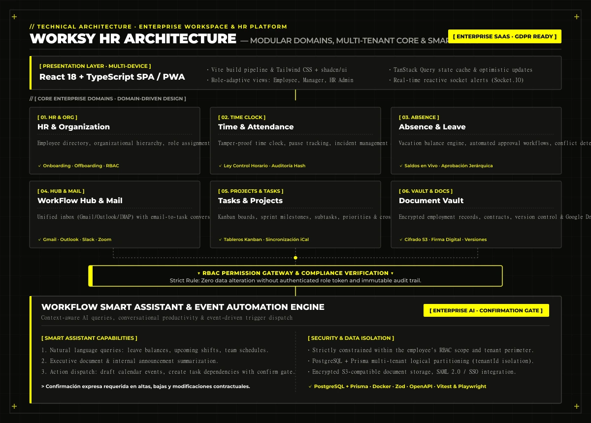

## 1. Product Vision: Eliminating Workplace Tool Fragmentation

Modern enterprises rely on a fragmented web of disconnected tools: standalone HR software, unlinked spreadsheets, internal chat tools, isolated calendars, separate task trackers, disparate cloud storage providers, and standalone attendance apps.

This tool sprawl breeds **data silos, manual friction, lack of auditability, and lost productivity**.

**Worksy (WorkFlow HR)** was engineered with a clear mandate: unify core business operations into a **single, secure, high-performance digital workspace** built on three pillars:

- **Centralization:** Consolidate workforce profiles, time-clock records, leave calendars, and project tasks into one coherent interface.
- **Automation:** Eliminate manual admin work through approval chains and event-driven automation triggers.
- **Connectivity:** Integrate natively with tools teams already use (Google Workspace, Microsoft 365, Slack, Zoom, Holded, DocuSign) without forcing disruptive migrations.

The platform is designed around a scalable **multi-tenant architecture**, tailored for high-growth businesses and multi-entity corporate structures with complex departmental hierarchies.

<figure class="my-8">
  
  <figcaption class="mt-2 text-center text-xs font-mono text-[#a3a39b]">// Real Worksy interface: Command Center cockpit with workforce metrics and daily operations</figcaption>
</figure>

---

## 2. Workforce Management & Organizational Structure

The core HR module provides administrative governance over company personnel and reporting hierarchies:

- **Centralized Employee Directory:** Unified workforce registry featuring comprehensive profiles, employment contracts, role histories, and start dates.
- **Departmental Structure & Org Charts:** Visual hierarchy mapping departments, functional units, team leads, and supervisor reporting lines.
- **Employee Self-Service Portal:** Private employee space to view contracts, download paystubs, review shift schedules, and manage absence requests.
- **Structured Onboarding & Offboarding:** Automated checklists for asset handover, digital contract signing, account provisioning, and departure protocols.
- **Role-Based Access Control (RBAC):** Strict permission boundary ensuring each user accesses strictly authorized records.

<figure class="my-8">
  
  <figcaption class="mt-2 text-center text-xs font-mono text-[#a3a39b]">// Centralized team directory with departmental structure and role-based permissions</figcaption>
</figure>

---

## 3. Compliant Time & Attendance Tracking

Worksy's time tracking system is built specifically to satisfy strict European and **Spanish daily time-tracking mandates**, ensuring legal validity and tamper resistance:

- **One-Click Shift Clocking:** Clock in, register breaks, and clock out via web browser or mobile devices with optional consented geolocation.
- **Real-Time Hour Computation:** Automatic computation of regular hours, statutory overtime, and part-time shift differentials.
- **Immutable Modification Logs:** Any employee-requested time adjustment creates a permanent audit record and requires explicit supervisor sign-off.
- **Manager Supervisory Views:** Team dashboards to flag undocumented absences, shifts exceeding statutory limits, or recurrent delays.
- **Certified Inspection Exports:** Instant export of legally compliant timesheets (PDF/Excel) formatted for labor audits and regulatory inspections.

<figure class="my-8">
  
  <figcaption class="mt-2 text-center text-xs font-mono text-[#a3a39b]">// Audit-proof daily attendance tracking with automated overtime computation</figcaption>
</figure>

---

## 4. Vacations, Statutory Leave & Absence Management

The leave management engine automates the entire request cycle, replacing messy email chains and error-prone spreadsheets:

- **Dynamic Balance Calculation:** Automatic balance accrual and deduction based on company policies, collective agreements, or seniority.
- **Customizable Leave Types:** Annual vacation, certified sick leave with attached documentation, parental leave, and personal days.
- **Hierarchical Approval Workflows:** Instant notification alerts for department leads to review, approve, or decline requests with one click.
- **Team Absence Calendar:** Proactive visualization for managers that prevents critical coverage conflicts across operational shifts.
- **Documented Justifications:** Automated archiving of medical leave certificates attached directly to the worker's employment file.

---

## 5. Synchronized Corporate Calendars & Scheduling

Worksy delivers a unified view of organizational schedules, syncing bidirectionally with leading calendar ecosystems:

- **Unified Corporate Planning:** Shift rotas, company holidays by office location, team milestones, and approved vacations displayed on a single timeline.
- **Bidirectional External Synchronization:** Native two-way sync with **Google Calendar, Microsoft Outlook Calendar, and Apple Calendar (via CalDAV and standard iCalendar protocols)**.
- **Elimination of Context Switching:** Workers view shifts and meetings directly in their personal calendar apps without having to toggle back and forth.

---

## 6. Project, Task & Team Management

The productivity module streamlines daily execution through agile workflows embedded right into the corporate platform:

- **Dynamic Kanban Boards:** Visual sprint and project workflows organized by department, initiative, or client deliverable.
- **Granular Task Ownership:** Task assignment, priority flags, deadlines, hierarchical subtasks, custom labels, and document attachments.
- **Bottleneck Diagnostics:** Team-wide overview panels enabling leaders to spot overdue items, blockers, or unbalanced workloads early.
- **Personal Productivity Space:** Focused personal view for each worker prioritizing immediate duties alongside daily meetings and shift hours.

<figure class="my-8">
  
  <figcaption class="mt-2 text-center text-xs font-mono text-[#a3a39b]">// Agile department-level Kanban boards with priority assignment and sprint deadlines</figcaption>
</figure>

---

## 7. WorkFlow Mail: Unified Corporate Email Inbox

A standout feature in Worksy is its centralized mail interface, bridging external client communication and internal task management:

- **Unified Multi-Account Inbox:** Aggregate corporate accounts from **Gmail, Microsoft Outlook, and standard IMAP/SMTP mail servers**.
- **One-Click Email-to-Task Conversion:** Transform client inquiries or vendor emails into assignable Kanban tasks, preserving the email thread for context.
- **Smart Message Classification:** Context-aware categorisation highlighting emails concerning HR matters, invoices, contracts, executive memos, or suppliers.
- **Security & Privacy:** Authorized via OAuth 2.0 delegated tokens; email credentials are never stored insecurely and only permitted metadata is ingested.

<figure class="my-8">
  
  <figcaption class="mt-2 text-center text-xs font-mono text-[#a3a39b]">// WorkFlow Mail: unified corporate inbox with integrated email-to-task conversion</figcaption>
</figure>

---

## 8. WorkFlow Hub: Centralized Enterprise Application Launcher

WorkFlow Hub acts as the organization's single digital desktop, giving employees instant access to daily cloud services:

- **Single Sign-On App Directory:** One-click launchpad for Slack, Microsoft Teams, Google Drive, OneDrive, SharePoint, Zoom, Dropbox, and internal legacy apps.
- **Role-Based Visibility Rules:** IT administrators specify which application shortcuts appear for specific teams or seniority levels.
- **Reduced Digital Fatigue:** Prevents tabs overload by organizing the company's tool sprawl into an orderly, single-pane dashboard.

---

## 9. WorkFlow Documents: Encrypted Document Vault

Secure cloud document vault for personnel files and corporate policies:

- **Digital Employee Vault:** Encrypted storage for employment contracts, addendums, monthly payslips, tax certificates, and licenses.
- **Departmental Repositories:** Shared team folders for employee handbooks, occupational risk guidelines, internal bylaws, and corporate templates.
- **Strict Access Auditing & Versioning:** Full version history and access control records ensuring sensitive personnel data remains confidential.
- **Cloud Storage Connectors:** Direct integration with Google Drive, OneDrive, and Dropbox to prevent fragmented file silos.

---

## 10. Internal Communications & Multi-Channel Alerts

Structured company-wide communications ensuring transparent, trackable information distribution:

- **Official Bulletins & Notices:** Broadcast corporate updates, safety protocols, and departmental news with read-receipt confirmations.
- **Confidential HR Inquiry Desk:** Direct channel for workers to raise private inquiries with the people operations team.
- **Reactive Notification Engine:** Real-time push updates for leave approvals, task deadlines, shift modifications, and document requests.
- **Multi-Channel Distribution:** In-app notification center, transactional email alerts, and webhook triggers to **Slack and Microsoft Teams**.

---

## 11. Role-Adaptive Dashboards & Business Analytics

Worksy customizes analytics and key metrics based on each user's operational scope:

- **Employee Dashboard:** Next shift alert, real-time clock counter, remaining leave balance, urgent tasks, and recent pay documents.
- **Manager Dashboard:** Live departmental attendance, team members on shift, active leaves, pending approval requests, and sprint progress.
- **Executive & HR Dashboard:** Global workforce KPIs (headcount, onboarding, turnover), aggregate absenteeism rates, overtime compliance indicators, and workload distribution. Includes date-range filtering and certified exports.

---

## 12. Technical Architecture & Engineering Specifications

Worksy is engineered as a domain-driven modular monolith, combining rapid development velocity, clean boundaries, and high reliability:

### Technology Stack
- **Frontend:** React 18, Strict TypeScript, Vite build tool, Tailwind CSS, and accessible shadcn/ui components. State managed with TanStack Query and Zustand.
- **Backend:** Node.js, Express, domain-driven modular structure, and schema validation via Zod.
- **Database:** PostgreSQL with Prisma ORM, comprehensive relational modeling, ACID transactions for timekeeping and payroll, and optimized indexing partitioned by `tenantId`.
- **Infrastructure & Services:** Docker containers for environment parity, S3-compatible object storage (AWS S3 / MinIO), WebSockets (Socket.IO) for real-time alerts, and Webhook dispatchers.
- **Quality Assurance:** Automated test suites powered by Vitest and Playwright, OpenAPI / Swagger specifications, and structured audit logs.

---

## 13. WorkFlow Smart Assistant: Enterprise AI

Worksy integrates a private AI assistant designed to accelerate day-to-day operations and workplace inquiries:

- **Natural Language Contextual Queries:** Answers frequent employee questions (*"How many vacation days do I have left?", "Who is on shift Friday?", "Summarize our remote work policy"*).
- **Executive Document Summaries:** Instant summaries of lengthy handbooks, safety manuals, or policy updates.
- **Action Dispatch with Safety Gate:** The assistant can draft leave requests or Kanban tasks, but **all sensitive operational actions require explicit user confirmation and RBAC validation**.

---

## 14. Event-Driven Workflow Automations

Worksy cuts manual friction through an event-driven automation engine:

- Automatic alerts to supervisors upon leave requests or attendance anomalies.
- Automated shift-start and shift-end clocking reminders.
- Onboarding sequence triggers (account provisioning, welcome packets, initial tasks) on the employee's start date.
- Proactive reminders for approaching project deadlines and expiring employment certifications.
- Automatic sync of approved leaves into department-wide Google or Microsoft calendar schedules.

---

## 15. Enterprise Ecosystem Integrations

Rather than displacing existing investments, Worksy orchestrates the organization's existing software stack:

- **Productivity Suites:** Full end-to-end integration with Google Workspace and Microsoft 365.
- **Team Communication:** Bidirectional alerts and event webhooks with Slack, Microsoft Teams, and Zoom.
- **Financial & ERP Systems:** Interoperability with accounting platforms like Holded and Sage for payroll and expense workflows.
- **Digital Signatures:** DocuSign and Signaturit integration for legally binding eIDAS-compliant electronic contracts.
- **Enterprise SSO & Identity:** Centralized authentication via Google Identity, Microsoft Entra ID, OpenID Connect, and SAML 2.0.

---

## 16. Security, Multi-Tenant Isolation & GDPR Compliance

Data security and regulatory compliance form the cornerstone of Worksy's architecture:

- **Multi-Tenant Logical Isolation:** Rigorous database-level partition by `tenantId`, ensuring no organization's data can ever be accessed by another client.
- **Role-Based Access Control (RBAC):** Four primary tiers (Superadmin, HR Admin, Department Lead, Worker) enforced on every API route.
- **End-to-End Encryption:** Encryption at rest for S3 files and API secrets, combined with TLS 1.3 transit encryption.
- **GDPR & Labor Law Compliance:** Data subject rights support, consent registries, access logging, and mandatory 4-year retention of attendance records.

---

## 17. Commercial Model & Acquisition Options

Worksy is engineered as an enterprise-grade platform ready for commercialization across two pathways:

- **SaaS Subscription Licensing:** Recurring tiered subscription based on workforce headcount (Starter, Professional, and Enterprise), with modular feature unlock.
- **Source Code Acquisition / Private Cloud Deployment:** Turnkey acquisition option for corporate buyers, technology holding firms, or enterprise investors seeking a production-ready, white-labelable operating system for private cloud or on-premise infrastructure.

---

## 18. Market Differentiators

Worksy stands out in the competitive enterprise software landscape:

1. **True HR & Productivity Convergence:** Bridges the gap between people management, daily time-clock compliance, and day-to-day task execution.
2. **Built-in Legal Compliance:** Native daily time-clock architecture compliant with strict Spanish and European labor regulations.
3. **Integrated WorkFlow Mail:** The only platform in its class allowing workers to convert client emails into managed tasks without leaving the app.
4. **Centralized App Launcher:** Unified single-pane launchpad for external cloud tools.
5. **Secure, Non-Intrusive AI:** Conversational assistant governed by an uncompromising human-in-the-loop confirmation gate.
6. **Modern, Maintainable Architecture:** Clean React 18, TypeScript, Node.js, and PostgreSQL codebase free from legacy tech debt.

---

## 19. Conclusion & Acquisition Inquiries

Worksy is a production-ready enterprise operating system engineered for reliability, security, and superior user experience.

If you represent an organization seeking to unify operations, or are a technology buyer or investor interested in licensing or acquiring the platform, contact Jaume Tur directly to schedule a technical walkthrough or evaluate acquisition opportunities.

**Worksy: Your Business. One Workspace. Total Control.**
