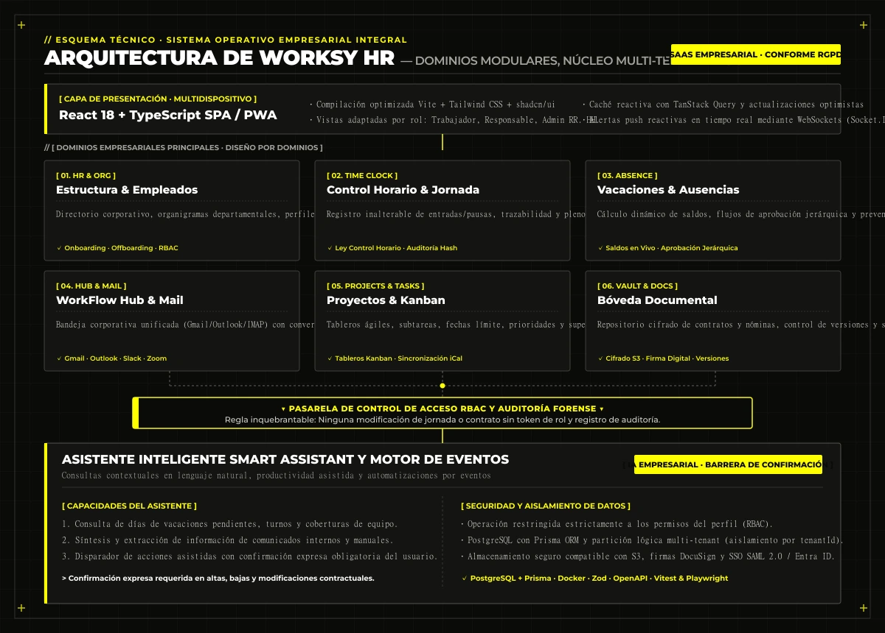

## 1. Visión del producto: Fin a la fragmentación de herramientas empresariales

En el día a día operativo, las organizaciones dependen de una multitud dispersa de programas independientes: software de recursos humanos, hojas de cálculo compartidas, clientes de mensajería interna, calendarios personales, gestores de tareas aislados, servicios de almacenamiento en la nube y terminales biométricas o aplicaciones de fichaje horario.

Esta dispersión tecnológica provoca **duplicidad de datos, cuellos de botella manuales, falta de trazabilidad y una pérdida sistemática de productividad**.

**Worksy (WorkFlow HR)** nace con una premisa de ingeniería clara: resolver la fragmentación corporativa ofreciendo un **centro de operaciones digitales unificado, seguro y de alto rendimiento**, articulado en tres pilares:

- **Centralización:** Toda la información de personal, calendarios, jornada y tareas converge en una sola interfaz coherente.
- **Automatización:** Supresión de tareas administrativas repetitivas mediante flujos de aprobación y disparadores de eventos en tiempo real.
- **Conectividad:** Integración nativa con las herramientas que las plantillas ya utilizan (Google Workspace, Microsoft 365, Slack, Zoom, Holded, DocuSign), evitando costosas curvas de migración forzada.

La plataforma está diseñada con una arquitectura multi-empresa (*multi-tenant*) escalable, apta tanto para pymes en crecimiento como para corporaciones con múltiples sedes, filiales y departamentos jerarquizados.

<figure class="my-8">
  
  <figcaption class="mt-2.5 text-center text-xs text-ink/70">Command Center de Worksy con KPIs de plantilla, accesos rápidos y panel operativo</figcaption>
</figure>

---

## 2. Gestión de empleados y estructura organizativa

El módulo central de personas proporciona el marco de gobernanza para administrar la plantilla y la estructura corporativa:

- **Directorio centralizado:** Base de datos unificada de trabajadores con fichas profesionales completas, puestos, contratos asociados, estados laborales y fechas de incorporación.
- **Estructura departamental y organigramas:** Definición visual de departamentos, áreas funcionales, responsables de equipo y jerarquías de supervisión.
- **Perfiles personalizados y autoservicio del empleado:** Cada empleado accede a un portal privado donde consultar su historial laboral, revisar horarios, descargar nóminas y gestionar solicitudes.
- **Flujos de Onboarding y Offboarding:** Listas de comprobación automatizadas para incorporaciones (entrega de equipos, firma de contratos, accesos) y bajas coordinadas de empleados.
- **Permisos granulares (RBAC):** Sistema estricto de control de acceso basado en roles que garantiza que cada usuario acceda exclusivamente a los datos que le corresponden.

<figure class="my-8">
  
  <figcaption class="mt-2.5 text-center text-xs text-ink/70">Directorio centralizado de plantilla con organigrama departamental y perfiles</figcaption>
</figure>

---

## 3. Control horario y gestión de jornada con trazabilidad legal

El sistema de control horario de Worksy está diseñado específicamente para satisfacer las exigencias de la **normativa española de registro diario de jornada laboral**, garantizando fiabilidad probatoria y ausencia de manipulación:

- **Fichaje de entradas, salidas y pausas:** Registro en un solo clic desde navegador web o dispositivo móvil con geolocalización opcional consentida.
- **Cómputo en tiempo real de horas trabajadas:** Desglose automático entre horas ordinarias, horas extraordinarias y jornadas parciales o reducidas.
- **Trazabilidad inalterable de modificaciones:** Cualquier corrección o incidencia solicitada por el trabajador queda registrada en un historial de auditoría inmutable, requiriendo la validación obligatoria del responsable.
- **Cuadro de mando para supervisores:** Vistas de equipo para detectar ausencias injustificadas, solapamientos, retrasos recurrentes o excesos de jornada.
- **Exportación oficial certificada:** Generación inmediata de informes de jornada en formatos estándar (PDF/Excel) listos para inspecciones de trabajo o auditorías laborales.

<figure class="my-8">
  
  <figcaption class="mt-2.5 text-center text-xs text-ink/70">Control horario con cómputo de horas ordinarias y extraordinarias conforme a la ley española</figcaption>
</figure>

---

## 4. Vacaciones, permisos y ausencias

El módulo de gestión de ausencias automatiza el ciclo de vida de peticiones laborales, eliminando cadenas de correos y hojas de cálculo desactualizadas:

- **Cómputo dinámico de saldos:** Cálculo automático de días de vacaciones devengados, disfrutados y pendientes según la política laboral de la empresa o convenio colectivo.
- **Tipologías de permiso configurables:** Gestión de vacaciones anuales, bajas médicas con justificante adjunto, permisos retribuidos, maternidad/paternidad y días de asuntos propios.
- **Flujos de aprobación en cadena:** Notificaciones inmediatas al responsable de departamento con opción de aprobar, rechazar o solicitar aclaraciones con un solo clic.
- **Calendario departamental de ausencias:** Visualización preventiva para coordinadores que impide solapamientos críticos en puestos estratégicos.
- **Trazabilidad documental:** Archivo automático de partes de baja médica y justificantes vinculados directamente al expediente del trabajador.

---

## 5. Calendarios corporativos y planificación sincronizada

Worksy proporciona una visión unificada de todos los hitos y compromisos de la organización, integrándose de forma bidireccional con los ecosistemas de calendario más extendidos:

- **Planificación corporativa integrada:** Cuadrantes de turnos, festivos de empresa por sede, eventos corporativos, fechas límite de proyectos y ausencias aprobadas en una sola vista.
- **Sincronización bidireccional externa:** Conexión nativa con **Google Calendar, Microsoft Outlook Calendar y Apple Calendar (mediante protocolos CalDAV y compatibilidad iCalendar)**.
- **Eliminación de la doble consulta:** Los empleados visualizan sus turnos laborales y reuniones de equipo directamente en sus aplicaciones de calendario personales sin necesidad de alternar herramientas.

---

## 6. Gestión de tareas, proyectos y equipos

El módulo de productividad transforma la coordinación operativa diaria mediante herramientas ágiles integradas en el entorno corporativo:

- **Tableros Kanban dinámicos:** Organización visual de flujos de trabajo por departamento, proyecto o iniciativa.
- **Gestión granular de tareas:** Asignación de responsables, fijación de prioridades, fechas de vencimiento, subtareas jerárquicas, etiquetas y archivos adjuntos.
- **Supervisión de cuellos de botella:** Paneles de seguimiento que permiten a los responsables detectar retrasos, bloqueos operativos o descompensación de cargas de trabajo.
- **Espacio personal de productividad:** Vista enfocada para cada trabajador donde priorizar sus tareas diarias asignadas en consonancia con sus horarios y reuniones.

<figure class="my-8">
  
  <figcaption class="mt-2.5 text-center text-xs text-ink/70">Tablero Kanban ágil por departamentos con gestión de prioridades y fechas límite</figcaption>
</figure>

---

## 7. WorkFlow Mail: Correo corporativo centralizado

Uno de los componentes diferenciales de mayor valor en Worksy es su cliente de correo centralizado, diseñado para cerrar la brecha entre la comunicación externa y la gestión de tareas internas:

- **Bandeja de entrada unificada:** Conexión de cuentas corporativas de **Gmail, Microsoft Outlook y servidores compatibles con IMAP/SMTP**.
- **Conversión de correo a tarea en un clic:** Capacidad de transformar cualquier correo de clientes o proveedores en una tarea del tablero Kanban asignada a un empleado, vinculando el hilo de mensajes al registro operativo.
- **Clasificación inteligente:** Detección contextual de comunicaciones prioritarias relativas a recursos humanos, nóminas, contratos, dirección o proveedores.
- **Seguridad y privacidad:** Conexión delegada mediante protocolos seguros OAuth 2.0 que garantiza que las credenciales de correo no se almacenan y que sólo se sincroniza la información estrictamente autorizada.

<figure class="my-8">
  
  <figcaption class="mt-2.5 text-center text-xs text-ink/70">WorkFlow Mail: bandeja corporativa unificada y conversión de correos en tareas operativas</figcaption>
</figure>

---

## 8. WorkFlow Hub: Centro unificado de aplicaciones empresariales

WorkFlow Hub actúa como el escritorio digital unificado de la organización, centralizando los accesos a las herramientas de trabajo cotidianas:

- **Lanzador unificado de aplicaciones:** Acceso centralizado a servicios como Slack, Microsoft Teams, Google Drive, OneDrive, SharePoint, Zoom, Dropbox y plataformas internas de la compañía.
- **Políticas de visibilidad por rol:** Los administradores definen qué herramientas y accesos directos se muestran a cada departamento o perfil profesional.
- **Reducción de la fatiga digital:** Se evita que los trabajadores dispersen su atención abriendo decenas de pestañas sueltas; todo el ecosistema corporativo queda ordenado en una sola interfaz.

---

## 9. WorkFlow Documents: Bóveda digital y gestión documental segura

Repositorio seguro y cifrado para la custodia de la documentación laboral y corporativa:

- **Expediente digital del empleado:** Almacenamiento clasificado de contratos, anexos laborales, nóminas mensuales, certificados de retenciones y títulos profesionales.
- **Repositorio documental departamental:** Carpetas compartidas para manuales de acogida, políticas de prevención de riesgos laborales (PRL), normativas internas y plantillas oficiales.
- **Control estricto de versiones y accesos:** Trazabilidad de subida, consulta y modificación de archivos con permisos específicos para garantizar la confidencialidad.
- **Conectores con almacenamiento externo:** Sincronización transparente con Google Drive, OneDrive y Dropbox para evitar silos de información.

---

## 10. Comunicación interna y notificaciones multicanal

Sistema integral de comunicación corporativa para garantizar una difusión transparente y efectiva de la información:

- **Comunicados oficiales y tablón de anuncios:** Publicación de noticias de empresa, cambios normativos y comunicados departamentales con confirmación de lectura.
- **Canal de consultas a RR. HH.:** Sistema bidireccional y confidencial para resolución de dudas laborales de la plantilla.
- **Centro de notificaciones reactivo:** Avisos en tiempo real sobre aprobaciones de vacaciones, vencimientos de tareas, turnos y alertas laborales.
- **Integración multicanal:** Notificaciones push en la plataforma, avisos por correo electrónico y disparadores directos hacia canales de **Slack y Microsoft Teams**.

---

## 11. Dashboard y analítica empresarial por roles

Worksy adapta la presentación de métricas según las responsabilidades y nivel de acceso de cada usuario:

- **Dashboard del trabajador:** Resumen de próxima jornada laboral, contador de horas fichadas, días de vacaciones restantes, tareas urgentes y documentos recientes.
- **Dashboard de responsable de equipo:** Visión en vivo de presencia del departamento, empleados activos en turno, ausencias del día, solicitudes pendientes de aprobación y estado de tareas.
- **Dashboard directivo y de RR. HH.:** Indicadores globales de plantilla (altas, bajas, rotación), estadísticas agregadas de absentismo, cumplimiento normativo de jornada y evolución del volumen de trabajo. Filtros por periodo y exportaciones inmediatas.

---

## 12. Arquitectura técnica e ingeniería del sistema

La plataforma está diseñada mediante una arquitectura modular monolítica orientada a dominios (*modular monolith*), garantizando rapidez de desarrollo, facilidad de despliegue y máxima estabilidad operativa:

<figure class="my-8">
  
  <figcaption class="mt-2.5 text-center text-xs text-ink/70">Esquema de arquitectura técnica de Worksy con React 18, Node.js y PostgreSQL</figcaption>
</figure>

### Pila tecnológica (Tech Stack)
- **Frontend:** React 18, TypeScript en modo estricto, Vite como empaquetador ultrarrápido, Tailwind CSS y catálogo de componentes accesibles shadcn/ui. Gestión de estado con TanStack Query y Zustand.
- **Backend:** Node.js, Express, arquitectura modular dividida por dominios de negocio y validación estricta de esquemas mediante Zod.
- **Base de datos:** PostgreSQL gestionado a través de Prisma ORM, con modelado relacional completo, transacciones ACID para operaciones de jornada y nóminas, e indexación optimizada por `tenantId`.
- **Infestatructura y servicios:** Contenedores Docker para despliegues consistentes, almacenamiento de archivos compatible con Amazon S3 / MinIO, WebSockets (Socket.IO) para alertas en tiempo real y pasarela de Webhooks para integraciones externas.
- **Calidad de software:** Batería de pruebas automatizadas con Vitest y Playwright, especificación de API con OpenAPI / Swagger y registros de auditoría estructurados.

---

## 13. WorkFlow Smart Assistant: Inteligencia artificial corporativa

Worksy incorpora un asistente inteligente diseñado para optimizar el acceso a la información y agilizar procesos internos:

- **Consultas contextuales en lenguaje natural:** Respuestas inmediatas a preguntas frecuentes de los empleados (*«¿cuántas vacaciones me quedan?», «¿quién está de guardia el viernes?», «resume el protocolo de teletrabajo»*).
- **Extracción y síntesis documental:** Localización y resumen de manuales internos, políticas de empresa y comunicados corporativos.
- **Asistencia operativa bajo confirmación:** El asistente puede redactar solicitudes de permiso o crear tareas en el tablero Kanban, pero **toda acción operativa sensible exige la confirmación expresa del usuario y la validación obligatoria de los permisos RBAC**.

---

## 14. Automatizaciones basadas en eventos

Worksy elimina las intervenciones manuales rutinarias mediante un motor de flujos automáticos:

- Avisos automáticos a supervisores ante solicitudes de vacaciones o incidencias de fichaje.
- Recordatorios de fichaje pendientes al inicio y fin de jornada.
- Disparo de flujos de onboarding (creación de cuentas, envío de bienvenida, asignación de tareas iniciales) en la fecha de alta.
- Alertas de proximidad de fecha límite en tareas críticas y vencimiento de documentación laboral.
- Sincronización automática de eventos de vacaciones en los calendarios de equipo de Google o Microsoft.

---

## 15. Ecosistema de integraciones empresariales

La plataforma no reemplaza las inversiones previas de la empresa, sino que actúa como núcleo articulador:

- **Suites de productividad:** Google Workspace y Microsoft 365 integradas de extremo a extremo.
- **Comunicación en equipo:** Notificaciones bidireccionales con Slack, Microsoft Teams y Zoom.
- **Gestión financiera y ERP:** Compatibilidad con plataformas contables como Holded y Sage para exportación de datos laborales.
- **Firma digital legal:** Conexión con DocuSign y Signaturit para firma electrónica de contratos con validez legal europea (eIDAS).
- **Identidad corporativa y SSO:** Autenticación centralizada mediante Google Identity, Microsoft Entra ID, OpenID Connect y SAML 2.0.

---

## 16. Seguridad, aislamiento multi-tenant y cumplimiento RGPD

La seguridad y la confidencialidad de los datos corporativos constituyen el núcleo de la ingeniería de Worksy:

- **Aislamiento multi-inquilino (*multi-tenant*):** Partición lógica estricta a nivel de base de datos (`tenantId`) que asegura que ninguna organización pueda acceder bajo ninguna circunstancia a los registros de otra empresa.
- **Control de acceso basado en roles (RBAC):** Cuatro perfiles principales (Superadministrador, Administrador de RR. HH., Responsable de Departamento y Trabajador) con validación obligatoria en servidor.
- **Cifrado de extremo a extremo:** Cifrado en reposo para archivos en S3 y credenciales de integración, y cifrado en tránsito mediante TLS 1.3.
- **Conformidad con RGPD y normativa española:** Derechos ARCO/RGPD, registro de consentimientos, auditoría de accesos a datos personales y conservación de registros de jornada durante el plazo legal de cuatro años.

---

## 17. Modelo comercial y modalidades de adquisición

Worksy está concebida como una plataforma de alto rendimiento preparada para explotación comercial en dos modalidades:

- **Licenciamiento SaaS por suscripción:** Comercialización recurrente por tramos de plantilla con planes escalonados (Básico, Profesional y Enterprise), con activación inmediata de módulos según las necesidades del cliente.
- **Adquisición de código fuente o implantación *On-Premise* / Nube Privada:** Opción para inversores, grandes corporaciones o compradores tecnológicos que requieran una solución llave en mano para desplegar bajo su propia marca, con infraestructura dedicada y soberanía completa de datos.

---

## 18. Factores diferenciales en el mercado

Worksy se distingue de los programas tradicionales de RR. HH. por su enfoque holístico:

1. **Convergencia real de RR. HH. y productividad:** Supera los silos tradicionales reuniendo jornada, vacaciones, tareas Kanban y correo en un único entorno.
2. **Cumplimiento legal garantizado:** Registro diario inalterable adaptado punto por punto a la normativa española.
3. **WorkFlow Mail integrado:** Única plataforma del segmento que permite convertir hilos de correo en tareas operativas sin salir de la aplicación.
4. **Hub de aplicaciones:** Escritorio unificado para herramientas como Slack, Drive y Teams.
5. **Inteligencia artificial con barrera de seguridad:** Asistente IA que facilita el trabajo diario sin comprometer la seguridad ni modificar datos sin confirmación.
6. **Arquitectura moderna y mantenible:** Base de código limpia con React 18, TypeScript, Node.js y PostgreSQL, sin dependencias obsoletas ni deuda técnica.

---

## 19. Conclusión y contacto para adquisición o implantación

Worksy representa una solución empresarial completa y lista para producción, diseñada con los más altos estándares de robustez, seguridad y experiencia de usuario.

Si representas a una organización interesada en centralizar sus operaciones, o eres un comprador tecnológico o inversor interesado en adquirir o licenciar la plataforma, ponte en contacto directo para concertar una demostración técnica o evaluar propuestas de adquisición.

**Worksy: Gestión empresarial centralizada. Control operativo total. Máxima productividad.**
