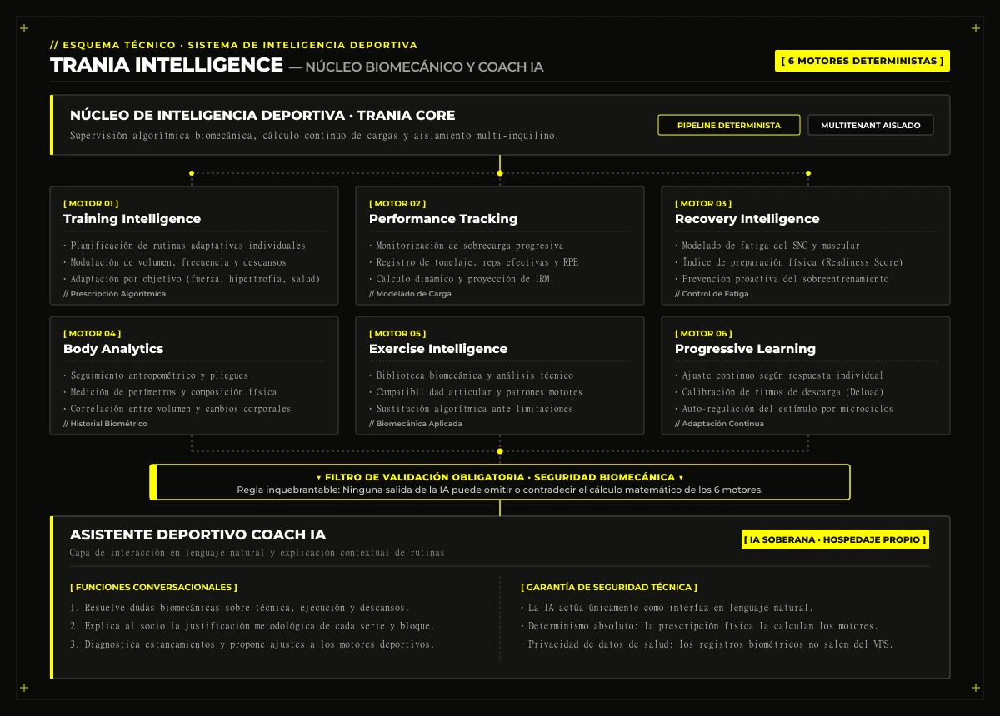

## 1. ¿Qué es TranIA? Visión general del ecosistema

**TranIA** es una plataforma inteligente de gestión deportiva de última generación diseñada específicamente para gimnasios, centros deportivos, estudios de entrenamiento funcional y entrenadores personales.

Su propósito fundamental es erradicar la fragmentación operativa tradicional unificando en un **único ecosistema tecnológico** la gestión integral del negocio, los socios, el control de instalaciones, los entrenamientos y la monitorización continua del rendimiento deportivo.

La plataforma articula dos grandes dimensiones complementarias:

- **TranIA Manager:** Centro neurálgico de gestión, administración operativa, facturación y gobernanza del gimnasio.
- **TranIA Intelligence:** Núcleo de inteligencia deportiva, planificación biomecánica y análisis avanzado del rendimiento físico.

TranIA está concebida como una plataforma **SaaS personalizable, multi-gimnasio (multi-tenant)** y optimizada para operar con una experiencia fluida tanto en entorno web de escritorio como en aplicaciones móviles y PWA.

---

## 2. TranIA Manager — Gestión y administración del centro deportivo

El módulo de administración proporciona a los propietarios, gerentes y coordinadores un control total sobre las áreas operativas del centro:

<figure class="my-8">
  
  <figcaption class="mt-2 text-center text-xs font-mono text-[#a3a39b]">// Interfaz real de TranIA Manager: cuadro de mando, socios activos y gestión de instalaciones</figcaption>
</figure>

### Socios y clientes
- **Registro y altas/bajas:** Fichas personales completas con historial unificado de actividad, contratos y estado administrativo.
- **Control de accesos sin fricción:** Validación de entradas mediante lectura de **código QR dinámico** desde el móvil del socio.
- **Membresías y renovaciones:** Gestión del ciclo de vida de cuotas, caducidades y asignación personalizada de entrenadores.
- **Monitorización de asistencia:** Registro en tiempo real de entradas al centro y frecuencia de uso de las instalaciones.

### Membresías, facturación y pagos
- **Tarifas y planes flexibles:** Creación de cuotas recurrentes, pases temporales, bonos de sesiones y promociones.
- **Cobros automatizados y remesas:** Emisión de facturas y recibos con conciliación bancaria e integración con pasarelas de pago.
- **Gestión de vencimientos:** Detección proactiva de pagos pendientes, cuotas vencidas y avisos de renovación automática.
- **Trazabilidad económica:** Historial financiero completo y auditable de cada socio.

### Empleados, entrenadores y turnos
- **Gestión de plantilla:** Administración de perfiles profesionales con sistema granular de roles y permisos.
- **Asignación y carteras:** Vinculación de socios a entrenadores según especialidad, objetivo y disponibilidad.
- **Control de turnos y tareas:** Cuadrantes horarios, registro de actividad laboral y seguimiento de tareas diarias del personal.

### Clases y actividades dirigidas
- **Programación de calendario:** Planificación semanal/mensual de clases colectivas (spinning, pilates, cross-training, etc.).
- **Reservas de plazas en tiempo real:** Control automático de aforos por sala para evitar masificación.
- **Listas de espera dinámicas:** Asignación automática de plazas libres tras cancelaciones y registro de asistencia efectiva.

### Instalaciones, equipamiento y mantenimiento
- **Inventario digital de máquinas:** Catálogo detallado de equipamiento con código de identificación y zona asignada.
- **Estado operativo y averías:** Reporte inmediato de incidencias técnicas en máquinas y seguimiento de su estado de uso.
- **Mantenimiento planificado:** Historial de reparaciones, revisiones preventivas programadas y registro de proveedores técnicos.

<figure class="my-8">
  
  <figcaption class="mt-2 text-center text-xs font-mono text-[#a3a39b]">// Catálogo biomecánico de ejercicios con clasificación técnica y grupos musculares</figcaption>
</figure>

### Informes y Business Analytics
- **Métricas clave en panel único:** Socios activos en tiempo real, tasa de abandono (*churn*), evolución de altas/bajas e ingresos recurrentes.
- **Ocupación y demanda:** Estadísticas de afluencia por franjas horarias y actividades de mayor rendimiento.

---

## 3. TranIA Intelligence — Seis motores de cálculo deportivo y Coach IA

A diferencia de las aplicaciones de fitness convencionales basadas en rutinas genéricas, TranIA sustenta su inteligencia en **seis motores matemáticos y biomecánicos especializados**:

1. **Training Intelligence:** Creación y planificación algorítmica de rutinas personalizadas según el nivel físico, objetivo (fuerza, hipertrofia, resistencia, salud), frecuencia disponible y restricciones anatómicas.
2. **Performance Tracking:** Registro analítico de sobrecarga progresiva: tonelaje, repeticiones efectivas, cálculo dinámico de 1RM, escala de esfuerzo percibido (RPE) y curvas de rendimiento temporal.
3. **Recovery Intelligence:** Evaluación de la fatiga del sistema nervioso y muscular, análisis de descanso y cálculo de preparación física (*readiness*) para modular el volumen del siguiente entrenamiento y prevenir el sobreentrenamiento.
4. **Body Analytics:** Seguimiento biométrico detallado: composición corporal, perímetros musculares, porcentaje graso y evolución dimensional del socio.
5. **Exercise Intelligence:** Biblioteca técnica con análisis biomecánico de cada movimiento, evaluación de compatibilidad articular y prescripción algorítmica de alternativas ante molestias o limitaciones lesionales.
6. **Progressive Learning:** Adaptación continua del estímulo basada en la respuesta real registrada de cada individuo, refinando los ritmos de descarga (*deloads*) y los incrementos de carga.

### Asistente inteligente Coach
TranIA incorpora un asistente conversacional avanzado sustentado en **modelos de IA propios**:
- Resuelve dudas técnicas sobre ejercicios, descansos y nutrición básica de apoyo.
- Interpreta y explica al socio la lógica detrás de cada bloque de su rutina.
- Diagnostica estancamientos y sugiere ajustes metodológicos fundamentados.
- **Garantía de rigor técnico:** Las decisiones deportivas son calculadas y validadas por los motores matemáticos deterministas de TranIA. La IA actúa como capa de comunicación inteligente, pero **no puede alterar datos arbitrariamente ni saltarse las restricciones de seguridad biomecánica**.

---

## 4. Experiencia del cliente y arquitectura White Label

### Aplicación del socio (Web & Móvil)
Cada cliente disfruta de una aplicación intuitiva e instalable donde puede:
- Visualizar sus entrenamientos del día con instrucciones técnicas y descansos pautados.
- Registrar series, pesos levantados y sensaciones serie a serie.
- Consultar su evolución física mediante gráficas interactivas de fuerza y medidas.
- Reservar plazas en actividades colectivas con un solo toque.
- Acceder a su carné digital con **código QR** para acceso al torno del gimnasio.
- Consultar su estado de cuota, recibos y avisos del centro.
- Interactuar con el asistente Coach para consultar dudas de su sesión.

### Personalización White Label por gimnasio
Cada centro deportivo proyecta su propia identidad de marca sin costes desorbitados de desarrollo individual:
- Logotipo, isotipo y nombre comercial propio.
- Paleta de colores corporativos aplicada en toda la interfaz.
- Imágenes de bienvenida y banners promocionales propios.
- Los socios identifican visualmente a su gimnasio al iniciar sesión, preservando la fidelidad de marca bajo una infraestructura tecnológica común de alta disponibilidad.

---

## 5. Hoja de ruta y funcionalidades de evolución futura

Las siguientes líneas de desarrollo representan la hoja de ruta estratégica para las próximas fases de expansión de TranIA:

- **A. Plano interactivo del gimnasio:** Mapeo visual e interactivo de las instalaciones con diseño por zonas (peso libre, cardio, maquinaria guiada, salas dirigidas). Permite reorganización *drag-and-drop* de máquinas, cálculo de pasillos de seguridad y consulta del estado de cada puesto sobre el plano.
- **B. Control económico y financiero avanzado:** Cuadro de mando de rentabilidad en tiempo real con contabilidad de facturación emitida y pendiente, desglose de costes fijos (personal, suministros, licencias) y costes variables de mantenimiento, con proyección de flujo de caja y beneficio neto.
- **C. Gestión inteligente del mantenimiento:** Trazabilidad integral del ciclo de vida de cada máquina (fecha de compra, garantía, horas de uso estimadas, coste acumulado de recambios y mano de obra) con cálculo comparativo para decidir entre reparación o sustitución.
- **D. Control de ocupación en tiempo real:** Medición continua de personas dentro del centro y densidad por salas mediante sincronización con tornos QR y compatibilidad con sensores IoT, generando alertas de horas punta y recomendaciones para redistribución de aforo.
- **E. Compras e inventario:** Gestión de existencias de material de desgaste, equipamiento auxiliar y productos de recepción (bebidas, suplementación), con registro de proveedores y pedidos de reposición automatizados.
- **F. Gestión documental segura:** Bóveda digital con cifrado y control de permisos para custodiar contratos de socios, contratos de entrenadores, revisiones técnicas reglamentarias de instalaciones y seguros de responsabilidad civil.
- **G. TranIA Business Intelligence:** Modelos predictivos para la toma de decisiones gerenciales: detección temprana del riesgo de baja de socios (*churn prediction*), análisis de rentabilidad por tipo de membresía y optimización de horarios de clases.
- **H. Automatizaciones inteligentes:** Flujos automáticos de fidelización para reactivar socios que acumulan días sin acudir, recordatorios automáticos de cuotas por vencer, felicitaciones y alertas técnicas de revisión de maquinaria.

---

## 6. Modelo comercial y modalidades de despliegue

<figure class="my-8">
  
  <figcaption class="mt-2 text-center text-xs font-mono text-[#a3a39b]">// Panel de gestión multi-inquilino de centros deportivos y franquicias en TranIA</figcaption>
</figure>

TranIA está planteada para responder a las necesidades de gimnasios de cualquier escala:

- **TranIA Estándar:** Acceso a la plataforma bajo la identidad visual de TranIA, ideal para estudios de entrenamiento personal y centros boutique.
- **TranIA Personalizada (White Label):** Personalización estética integral con la marca del gimnasio en web y aplicación móvil.
- **Planes de suscripción escalonados:**
  - **Free:** Funcionalidades esenciales para entrenadores independientes o centros pequeños.
  - **Pro:** Gestión completa del centro, facturación automatizada y motores de inteligencia deportiva.
  - **Elite:** Capacidades avanzadas de Business Intelligence, White Label total, automatizaciones avanzadas y soporte preferente.
- **Despliegue en VPS independiente:** Capacidad de desplegar instalaciones aisladas en servidores dedicados o VPS para grandes franquicias que exijan estricto aislamiento de base de datos.

---

## 7. Filosofía de ingeniería y arquitectura tecnológica

TranIA se rige por principios de ingeniería de software enfocados en la solidez y la longevidad del producto:

- **Base de código unificada (Single Codebase):** Mantenimiento simplificado y evolución continua sin divergencias ni bifurcaciones frágiles.
- **Arquitectura desacoplada y modular:** Clara separación funcional entre la capa de administración de negocio (TranIA Manager) y los motores de cálculo (TranIA Intelligence).
- **Aislamiento estricto de datos:** Modelo multi-inquilino seguro con partición lógica de datos que garantiza la privacidad absoluta entre gimnasios competidores.
- **IA soberana y controlada:** Modelos de inteligencia artificial alojados en infraestructura propia controlada, garantizando la privacidad de los datos de salud de los socios.
- **Determinismo deportivo:** La IA asiste y explica, pero las matemáticas del entrenamiento y la biomecánica están gobernadas por algoritmos deterministas contrastados.
- **Sobriedad tecnológica:** Cero dependencias innecesarias; priorización de rendimiento nativo, tiempos de respuesta instantáneos y contención de costes de servidor.

---

## 8. Visión final

TranIA nace para superar la dicotomía tradicional entre los programas administrativos y las aplicaciones de entrenamiento. Representa un ecosistema holístico donde la eficiencia en la gestión del negocio potencia directamente los resultados físicos del socio.

**TranIA: gestión inteligente del gimnasio y evolución inteligente del entrenamiento.**
