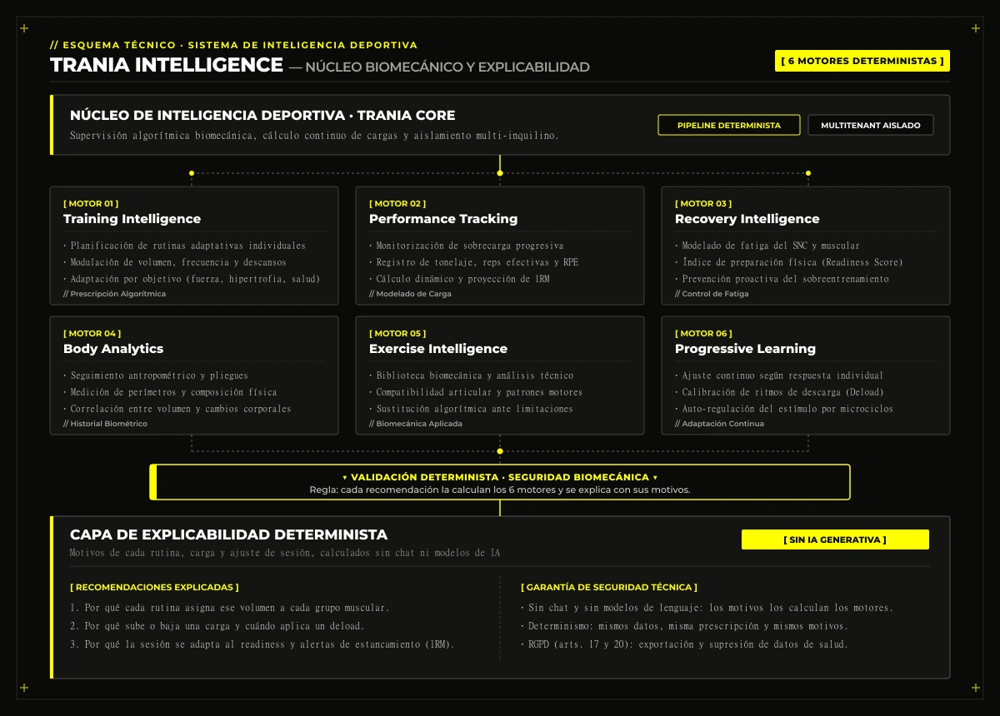

## 1. ¿Qué es TranIA? Visión general del ecosistema

**TranIA** es una plataforma de gestión deportiva diseñada para gimnasios, centros deportivos, estudios de entrenamiento funcional y entrenadores personales.

Su propósito es eliminar la fragmentación operativa tradicional unificando en un **único ecosistema tecnológico** la gestión del negocio, los socios, el control de instalaciones, los entrenamientos y el seguimiento del rendimiento deportivo.

La plataforma articula dos dimensiones complementarias:

- **TranIA Manager:** Centro de gestión, administración operativa, facturación y gobernanza del gimnasio.
- **TranIA Intelligence:** Núcleo de inteligencia deportiva: planificación, progresión de cargas y análisis del rendimiento físico.

TranIA es una plataforma **SaaS multi-gimnasio (multi-tenant)**, usable desde el navegador y desde una aplicación móvil para socios.

---

## 2. TranIA Manager — Gestión y administración del centro deportivo

El módulo de administración proporciona a propietarios, gerentes y coordinadores un control completo de las áreas operativas del centro:

<figure class="my-8">
  
  <figcaption class="mt-2 text-center text-xs font-mono text-[#a3a39b]">// Interfaz real de TranIA Manager: cuadro de mando, socios activos y gestión de instalaciones</figcaption>
</figure>

### Socios y clientes
- **Registro y altas/bajas:** Fichas personales con historial de actividad, contratos y estado administrativo.
- **Control de accesos:** Validación de entradas mediante lectura de **código QR dinámico** desde el móvil del socio, con rotación del código bajo demanda.
- **Membresías y renovaciones:** Gestión del ciclo de vida de cuotas, caducidades y asignación de entrenadores.
- **Monitorización de asistencia:** Registro de entradas al centro y frecuencia de uso.

### Membresías, facturación y pagos
- **Tarifas y planes flexibles:** Cuotas recurrentes, pases, bonos de sesiones y promociones.
- **Facturación:** Facturas numeradas y recibos en PDF imprimible según RD 1619/2012.
- **Pagos online:** Cobro mediante Stripe Checkout, con simulador de pagos para pruebas y suscripciones por categoría.
- **Trazabilidad económica:** Historial financiero de cada socio.

### Empleados, entrenadores y turnos
- **Gestión de plantilla:** Perfiles profesionales con roles y permisos granulares por gimnasio.
- **Asignación:** Vinculación de socios a entrenadores.
- **Horarios y tareas:** Horarios laborales del personal y seguimiento de tareas.

### Clases y actividades dirigidas
- **Calendario:** Planificación de clases colectivas con recurrencia semanal.
- **Reservas con control de aforo:** Reserva de plazas y control de capacidad por sesión.
- **Listas de espera:** Asignación de plazas libres tras cancelaciones.

### Instalaciones, equipamiento y mantenimiento
- **Inventario de equipamiento:** Catálogo de máquinas e instalaciones por zona.
- **Averías:** Reporte de incidencias técnicas y seguimiento de su estado.
- **Mantenimiento:** Historial de mantenimiento y revisiones programadas.

<figure class="my-8">
  
  <figcaption class="mt-2 text-center text-xs font-mono text-[#a3a39b]">// Catálogo biomecánico de ejercicios con clasificación técnica y grupos musculares</figcaption>
</figure>

### Informes y analítica
- **Panel de métricas:** Socios activos, altas/bajas de los últimos 30 días, ingresos del mes, pagos pendientes y membresías por vencer.
- **Ocupación:** Aforo actual del centro en tiempo real.
- **Volumen semanal:** Volumen efectivo por grupo muscular para socio y entrenador, con mapa de calor.

---

## 3. TranIA Intelligence — Seis motores de cálculo deportivo y explicabilidad

A diferencia de las aplicaciones de fitness con rutinas genéricas, TranIA basa sus decisiones en **seis motores matemáticos y biomecánicos deterministas**:

1. **Training Intelligence:** Generación algorítmica de rutinas según nivel, objetivo (fuerza, hipertrofia, resistencia, salud), frecuencia disponible y limitaciones.
2. **Performance Tracking:** Registro de sobrecarga progresiva: tonelaje, repeticiones, 1RM estimado (Epley), RPE y curvas de rendimiento.
3. **Recovery Intelligence:** Estado de adaptación y readiness diario para modular el volumen de la sesión y prevenir el sobreentrenamiento.
4. **Body Analytics:** Seguimiento de medidas, composición corporal y evolución del socio.
5. **Exercise Intelligence:** Biblioteca de ejercicios con sustituciones por material disponible (Smart Swap) y compatibilidad con limitaciones.
6. **Progressive Learning:** Progresión de cargas y periodización mesocíclica con semanas de descarga (*deloads*) basadas en el registro real del socio.

### Explicabilidad determinista
Cada recomendación se acompaña de sus motivos, calculados por los motores y sin chat ni modelos de lenguaje:
- Por qué una rutina asigna ese volumen a cada grupo muscular.
- Por qué se sube o baja una carga y cuándo se aplica un deload.
- Por qué la sesión de hoy se adapta según el readiness.
- Alertas de estancamiento con el histórico del ejercicio y su 1RM estimado.
- Motivos de cada sustitución de ejercicio según el material disponible (Smart Swap).

---

## 4. Experiencia del socio y arquitectura White Label

### Aplicación del socio (Web y móvil)
Cada socio dispone de una aplicación donde puede:
- Consultar el entrenamiento del día y sustituir ejercicios por otros del material disponible (Smart Swap).
- Registrar series, pesos y repeticiones, con autocompletado, temporizador de descanso con notificación y modo entrenamiento en vivo.
- Crear entrenamientos libres y añadir o quitar ejercicios sobre la marcha.
- Calcular los discos necesarios para cada carga en barra.
- Consultar su evolución con gráficas de fuerza, medidas y volumen semanal.
- Importar y exportar su historial desde Hevy o Strong, y exportar sus datos conforme al RGPD (art. 20).
- Compartir un resumen del entrenamiento con la identidad de su gimnasio.
- Reservar plazas en clases colectivas.
- Acceder a su carné digital con **código QR** para el torno del gimnasio.
- Entrenar sin gimnasio: cuenta personal con espacio privado, sin membresía.

### Personalización White Label por gimnasio
Cada centro aplica su identidad de marca sin desarrollo a medida:
- Logotipo, nombre comercial y paleta de colores aplicados en la interfaz.
- Los socios ven la identidad de su gimnasio al iniciar sesión.
- Infraestructura común con datos aislados por gimnasio.

---

## 5. Hoja de ruta y funcionalidades de evolución futura

Líneas de desarrollo previstas, todavía no disponibles:

- **A. Plano interactivo del gimnasio:** Mapa de instalaciones por zonas, con reorganización de máquinas y estado de cada puesto.
- **B. Control económico avanzado:** Cuadro de mando de rentabilidad con facturación pendiente, costes fijos y variables y proyección de caja.
- **C. Gestión inteligente del mantenimiento:** Ciclo de vida de cada máquina (garantía, horas de uso, coste acumulado) para decidir entre reparar o sustituir.
- **D. Ocupación en tiempo real:** Medición de aforo por sala mediante tornos QR y sensores IoT.
- **E. Compras e inventario:** Existencias de material de desgaste y producto de recepción, con pedidos de reposición.
- **F. Bóveda documental:** Custodia cifrada de contratos, revisiones reglamentarias y seguros.
- **G. TranIA Business Intelligence:** Modelos predictivos de riesgo de baja y rentabilidad por tipo de membresía.
- **H. Automatizaciones de fidelización:** Avisos a socios inactivos, recordatorios de cuotas y alertas de revisión de maquinaria.

---

## 6. Modelo comercial y modalidades de despliegue

<figure class="my-8">
  
  <figcaption class="mt-2 text-center text-xs font-mono text-[#a3a39b]">// Panel de gestión multi-inquilino de centros deportivos y franquicias en TranIA</figcaption>
</figure>

- **TranIA Estándar:** Acceso con la identidad visual de TranIA.
- **TranIA Personalizada (White Label):** Identidad del gimnasio en web y aplicación móvil.
- **Planes:**
  - **Free:** hasta 50 socios y 2 entrenadores, gestión esencial.
  - **Pro:** hasta 250 socios y 10 entrenadores, inteligencia deportiva, seguimiento y bienestar.
  - **Elite:** socios y entrenadores ilimitados, analítica avanzada.
- **Límites por plan:** al alcanzar la cuota de socios o entrenadores, el sistema bloquea nuevas altas hasta ampliar el plan.
- **Despliegue en VPS independiente:** Instalaciones aisladas para franquicias con requisitos de aislamiento de base de datos.

---

## 7. Filosofía de ingeniería y arquitectura tecnológica

- **Base de código unificada:** Un único código para web, backend y motores, sin ramas divergentes.
- **Arquitectura modular:** Separación entre la gestión del negocio (TranIA Manager) y los motores de cálculo (TranIA Intelligence), que son Python puro sin dependencias de base de datos ni de interfaz.
- **Aislamiento estricto de datos:** Modelo multi-inquilino con partición lógica por gimnasio.
- **Determinismo deportivo:** Cada decisión de entrenamiento se calcula con algoritmos verificables y se explica al socio. No se usa IA generativa ni APIs externas de IA.
- **Privacidad y RGPD:** Exportación de datos (art. 20) y derecho de supresión (art. 17) para los datos de salud de los socios.
- **Sobriedad tecnológica:** Pocas dependencias, rendimiento nativo y coste de servidor contenido: PostgreSQL y Uvicorn ajustados para funcionar con 4 GB de RAM.
- **Demostración en línea:** La plataforma está completamente desplegada y operativa en producción: [jaumetur.es/trania](https://jaumetur.es/trania/).

---

## 8. Visión final

TranIA nace para superar la separación entre los programas administrativos y las aplicaciones de entrenamiento. Es un ecosistema donde la eficiencia en la gestión del negocio se traduce directamente en la evolución física del socio.

**TranIA: gestión inteligente del gimnasio y evolución inteligente del entrenamiento.**
